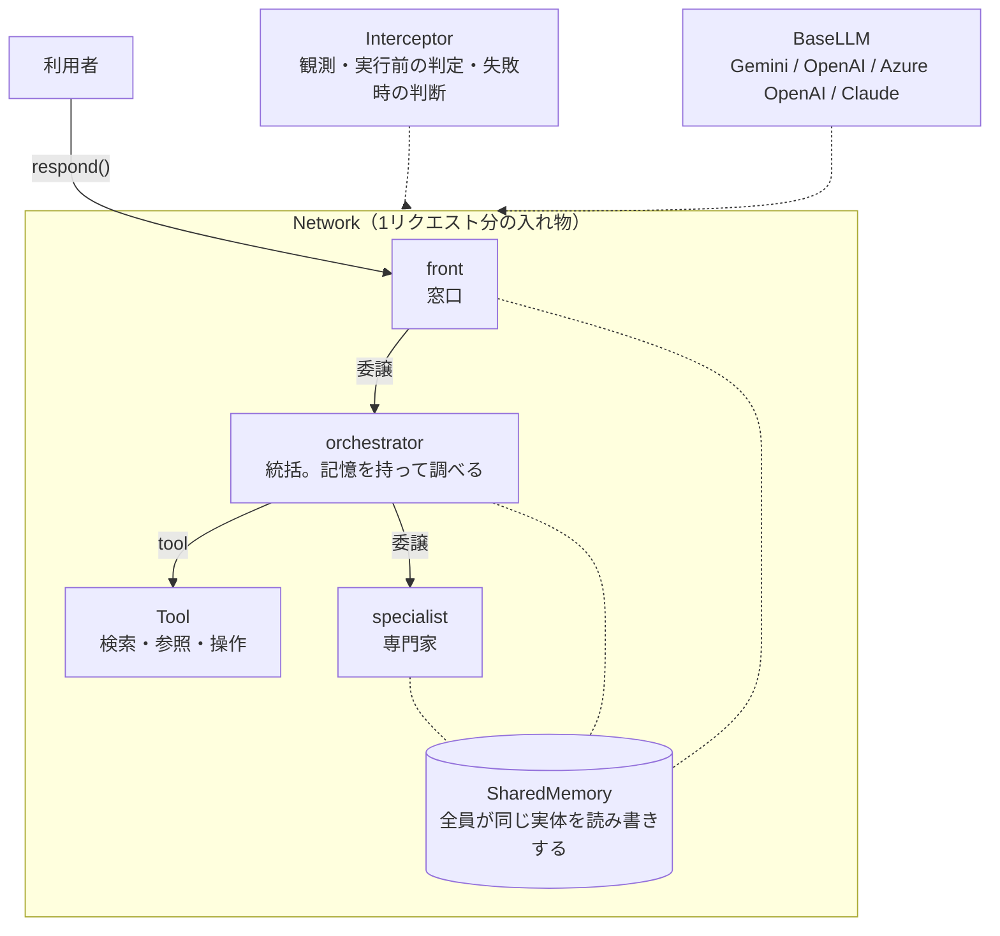

# statecraft の設計ドキュメント

statecraft の「なぜこう作ったか」と「中で何が起きているか」をまとめた文書です。

- 使い方の入口は、リポジトリ直下の [README.md](../README.md) にあります。
- サンプル（図書館）の解説は、[sampleの読み方.md](sampleの読み方.md) にあります。

> **この docs は下書きです。** 実装（`src/statecraft/`）と README を読んで書き起こしたもので、作者の確認が済んでいません。実装と食い違う所があれば、実装が正です。

---

## 読む順番

初めて読む人は、上から順に読んでください。

| 順 | 文書 | 何が分かるか |
|---|---|---|
| 1 | [concepts/philosophy.md](concepts/philosophy.md) | statecraft が何を大事にしているか |
| 2 | [glossary.md](glossary.md) | statecraft 独自の言葉 |
| 3 | [guides/first-agent.md](guides/first-agent.md) | 1エージェント・1ツールを動かすまで |
| 4 | [concepts/memory.md](concepts/memory.md) | 記憶の構造（statecraft の中心） |
| 5 | [reference/agent-loop.md](reference/agent-loop.md) | 1回の応答の中で何が起きているか |
| 以降 | 下の一覧から、必要になったものを | |

---

## 全体の地図

- **Network** が、エージェントたちと共有の記憶をまとめます（[reference/network.md](reference/network.md)）。
- **Agent** が、記憶を書きながら「調べる → 書き起こす → 次を決める」を繰り返します（[reference/agent-loop.md](reference/agent-loop.md)）。
- **Tool** は、エージェントから呼べる Python 関数です（[reference/tool.md](reference/tool.md)）。
- **Interceptor** は、ループの外から観測し、必要なら止めます（[reference/interceptor.md](reference/interceptor.md)）。
- **BaseLLM** は、LLM の提供元の違いを吸収します（[reference/llm-providers.md](reference/llm-providers.md)）。

---

## 文書の一覧

### concepts — なぜそうしたか

頭から読む読み物です。めったに変わりません。

| 文書 | 中身 |
|---|---|
| [philosophy.md](concepts/philosophy.md) | 設計の思想。以下の文書は、すべてここから導かれます |
| [memory.md](concepts/memory.md) | 記憶の構造、差分での書き込み、書き分け |
| [phases-and-prompts.md](concepts/phases-and-prompts.md) | phase の分け方と、1回の生成のプロンプトの組み立て |
| [knowledge.md](concepts/knowledge.md) | ナレッジや説明文を、いつ・どこに載せるか |
| [network-placement.md](concepts/network-placement.md) | エージェントの配置（ハブとスポーク）と責務の分け方 |
| [failure-handling.md](concepts/failure-handling.md) | 何を作り直し、何を作り直さないか |

### reference — 何がどうなっているか

必要な時に引く辞書です。コードを変えたら、同じ PR で直します。

| 文書 | 中身 |
|---|---|
| [agent-loop.md](reference/agent-loop.md) | Agent / ReflexAgent の1回の応答の流れ |
| [network.md](reference/network.md) | Network の役割、構築時の検証、`reset()` |
| [tool.md](reference/tool.md) | Tool / SchemaTool の項目と、戻り値の約束 |
| [interceptor.md](reference/interceptor.md) | 3つの窓口、イベント、判定の型と既定の向き |
| [llm-providers.md](reference/llm-providers.md) | BaseLLM の約束と、プロバイダごとの違い |
| [config.md](reference/config.md) | 設定ファイル（YAML / Markdown）の早見表 |

### guides — 目的別の手順

| 文書 | 中身 |
|---|---|
| [first-agent.md](guides/first-agent.md) | 最初の30分。1エージェント・1ツールを動かす |
| [add-llm-provider.md](guides/add-llm-provider.md) | 新しい LLM の提供元を足す |
| [mcp-tools.md](guides/mcp-tools.md) | MCP サーバーのツールを statecraft の Tool として使う |
| [testing.md](guides/testing.md) | LLM を呼ばずにテストを書く |

### その他

| 文書 | 中身 |
|---|---|
| [glossary.md](glossary.md) | 用語集 |
| [adr/](adr/) | 設計判断の記録（ADR） |

---

## このフォルダの書き方の約束

- **1ファイル1テーマ。** 1つの文書に複数の目的を持たせません。
- **concepts には「なぜ」を書きます。** 何をしているかはコードが語るので、なぜ他のやり方にしなかったかを書きます。
- **reference はコードと同じ PR で直します。** 別の場所に置くと、ほぼ確実に古くなります。
- **設計の判断を変えたら、ADR を足します。** 元の ADR は消さず、「状態」を書き換えて残します。
- **関数ごとの引数の説明は書きません。** docstring と型ヒントで足ります。
