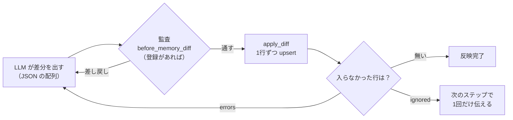

# 記憶の構造

記憶は statecraft の中心です。エージェントの生成は phase ごとに別々の呼び出しで、**生成をまたいで引き継がれるのは記憶だけ**です（→ [philosophy.md](philosophy.md)）。

定義は `src/statecraft/memory.py` にあります。

---

## 2種類の記憶

| | 誰が持つか | 何を入れるか |
|---|---|---|
| `SharedMemory` | Network に1つ。全エージェントが同じ実体を読み書きする | 判断に使う知識のほとんど |
| `PrivateMemory` | エージェントごと | 自分の作業の進行管理（`goals` / `tasks`）と、外へ出す必要が無い知識（`task_notes`） |

判断に使う知識は、原則として共有の記憶へ書きます。個別の記憶に置くと、他のエージェントから見えず、突き合わせも検証もできない情報が生まれるためです。

`ReflexAgent` は個別の記憶を持たず、共有の記憶を読むだけです。

### SharedMemory のフィールド

| フィールド | 中身 |
|---|---|
| `state_briefing` | その時点の総括（今どこにいて、何が分かり、何が分かっていないか）と、断片だけでは抜け落ちる文脈。毎回新しい id で1件足し、時系列で積み上がる |
| `user_back_grounds` | 依頼者についての読み。何を実現したいのか、何を前提に話しているのか |
| `vars` | 一字一句失われると困る値（ID・URL・SQL・キー） |
| `facts` | 今回の件について確かめた情報と、答えに使う一般知識。対象ごとの断片 |
| `ontology` | 対象領域の概念構造。概念が何で、互いにどう関係し、どう働くか。エージェント自身の世界モデル |
| `actions` | 何を確かめるために何を行い、結果どうなったか。空振りも残す |
| `decisions` | 何を採用し、何を採用しなかったか。調べるのを止める判断と、解釈の固定もここ |
| `hypotheses` | 根拠はあるが、まだ確定していない読み取り。依頼者の取り違えの読みも含む |
| `questions_to_research` | 手元の tool / agent で解決できる、未解決の論点（調べる問い） |
| `questions_to_ask` | 依頼者に聞かないと解決できない、未解決の論点（尋ねる問い）。最終回答で依頼者への問いになる |
| `requests` | **システムが書く。** 最初の委譲で構造化された依頼 |
| `conversation` | **システムが書く。** 利用者との会話の原文 |
| `agent_answers` | **システムが書く。** 委譲先が返した回答 |

### PrivateMemory のフィールド

| フィールド | 中身 |
|---|---|
| `goals` | このエージェントが今回達成すべきこと。依頼を写したものではなく、自分の責務に照らして判定した結果 |
| `tasks` | 次に何を実行するかの、システムへの指示（下で詳しく） |
| `task_notes` | 作業には要るが、相手には意味を持たない詳細（内部の識別子など）と、手元の tool / agent の使い方の取り決め |

---

## 書き込みは差分で行う

LLM は記憶を直接書き換えません。**差分の配列**を返し、システムがそれを当てます。

```json
[
  {"field": "facts", "id": "fact-1", "text": "一般利用者の貸出上限は5冊。"},
  {"field": "tasks", "id": "task-1", "text": "在庫を確かめるため", "status": "next", "target_names": ["check_stock"]}
]
```



### 差分の約束

- **同じ id なら差し替え、新しい id なら追記（upsert）。** 既存の項目を更新する時は、新しく分かったことを足した**全文**を書かせます。
- **消す経路はありません。** 不要になった情報は、消すのではなく新しい内容で上書きさせます。判断の履歴を失わないためです。
- **ルートは配列、行はフラット。** オブジェクトで包むと、定義していない操作のキー（`remove` など）を捏造する余地が生まれます。フィールドごとに配列をネストさせる形は、スキーマが深くなり、中身を埋めずに型だけを返す挙動が出やすくなります。
- **書けるフィールドは、スキーマの enum に並びます。** enum はフィールドの定義（dataclass）から自動で作られるので、フィールドを足せばスキーマも追従します。
- **システムが書くフィールドへの書き込みは、捨てます。** 差し戻しても直せないので、再生成のトークンを使わせません（`ignored` として次のステップで1回だけ伝えます）。
- **1行の失敗で全体を止めません。** 通る行は当て、失敗した行（`errors`）だけを差し戻して出し直させます。

差し戻しと作り直しの詳しい扱いは [failure-handling.md](failure-handling.md) にあります。

---

## 書き分け

どのフィールドへ書くかは、内容の性質で決まります。LLM には次の判断基準を渡しています（`memory.py` の `ROUTING_GUIDE`）。

| 内容 | 書き先 |
|---|---|
| 一字一句失われると困る値そのもの | `vars` |
| 今回の件について確認したこと | `facts` |
| 対象領域の概念が何で、どう関係し、どう働くか | `ontology` |
| 根拠はあるが、まだ確定していない読み取り | `hypotheses` |
| 自分が実際に行った調査・実行と、その結果 | `actions` |
| 何を採用し、何を採用しなかったかの判断 | `decisions` |
| 手元の tool / agent で埋められる、未解決の論点 | `questions_to_research` |
| 依頼者に聞かないと埋まらない、未解決の論点 | `questions_to_ask` |
| 依頼者が何を実現したいのか、何を前提に話しているのかの読み | `user_back_grounds` |
| 今どこにいて何が分かっていないかの総括 | `state_briefing` |
| これから追加で実行する作業 | `tasks` |
| 外に出す必要が無い作業上の知識 | `task_notes` |

取り違えやすい境界も、合わせて渡しています（`facts` と `ontology`、`facts` と `hypotheses`、`questions_to_research` と `questions_to_ask` など）。

### facts・ontology・state_briefing の3つで1組

`facts` は対象ごとの断片なので、それだけでは話が飛んで見えます。`ontology`（概念の構造）と `state_briefing`（断片どうしのつながりと今の理解）がそれを補います。最終回答を組み立てる側は、`facts` の羅列ではなく `state_briefing` を読んで筋をつかみます。

### 問いの置き場を2つに分けている理由

置き場が1つだった時、モデルは問いの形をしたものを全部そこへ入れ、調べても出てこないもの（依頼者にしか分からないこと）を探し続けました。名前を「調べる / 尋ねる」の動詞で対比させているのも、`open_questions` のような名前だと、どんな問いでも入りそうに見えたためです。

---

## tasks — システムへの指示

`tasks` は、次に何を実行するかをシステムへ伝える場所です。

| `status` | 意味 |
|---|---|
| `next` | 次に実行する |
| `next_parallel` | 次に、他と同時に実行する（互いの結果に依存しないもの） |
| `conditional` | 他のタスクの結果を待つ。何が確定すれば実行できるかを text に書く |
| `done` | 完了した |
| `unnecessary` | 前提が崩れた、または不要になった |

- **`target_names` に実在する tool / agent の名前を書いたものだけが、実行されます。** 自然言語で「規程を確認する」と書いても、何も起きません。
- **`next` が1つも無ければ、回答へ進みます。**
- **text には、goals のどこに答えるための実行かを書きます。** 手順（探す、開く、照合する）を書くと、完了の判定が「その手順を終えたか」になり、答えが手元にあっても次の手順が続きます。どう取るかがすでに決まっているなら、それも具体的に書きます。
- **実行したタスクは、同じ id で閉じます（`done` か `unnecessary`）。** 結果を見て次にやることが決まっても、実行したタスクを書き換えて `next` に戻さず、新しい id で立てます。
- **手元の材料で下せる判断は、タスクにしません。** 「〜を確認する」というタスクは、手元で下せる判断を次の実行へ送る形になりやすく、送った判断は誰にも下されないまま実行だけが続きます。

実行したタスクが `next` のまま残っていると、システムが検出して差し戻します（→ [failure-handling.md](failure-handling.md)）。

---

## 説明の置き場所

各フィールドの説明は、2つに分けて持ちます（`SHARED_MEMORY_GUIDE` / `PRIVATE_MEMORY_GUIDE`）。

| | 中身 | どこに載るか |
|---|---|---|
| `description` | 何を入れる場所か | 全 phase（system_instruction の共通部） |
| `how_to` | どう書くか | 記憶を書く phase だけ（`INITIAL_MEMORY` / `MEMORY_UPDATE`） |

記憶の**中身**は、説明とは別に、毎回変わる側（prompt）に載せます。説明と中身を交互に並べた方が守られやすいのですが、変わらない説明を毎回変わる中身と混ぜると、説明の分までプロンプトキャッシュに乗らなくなります。守られやすさより、トークンの費用を取っています。

`description` は、中身が空のフィールドについても常に全部出します。出し分けると、記憶が埋まるたびにこの文字列が変わり、キャッシュに乗らなくなるためです。

規則は1か所にだけ置きます。phase をまたいで効く規則（tasks の扱いなど）は `how_to` に、その phase でしか起きないことは phase の指示（`prompts.py`）に置きます。

---

## tool から記憶へ直接書く

一字一句正確に残したい値（受付番号、識別子など）は、tool が戻り値の `memory` で、LLM の要約を通さずに記憶へ書けます。

```python
return {
    "value": "予約を登録しました。受付番号は RSV-00123 です。",
    "memory": {"vars": ["予約受付番号: RSV-00123"]},
}
```

id はシステムが `tool名-フィールド名-連番` で採番します。tool は既存の記憶を知らないので、重複しない id を決められないためです。この経路は値をそのまま残すためのものなので、監査（`before_memory_diff`）は通りません。

---

## ターンをまたぐ引き継ぎ

共有の記憶を次のターンへどこまで持ち越すかは、**利用側が決めます**。何を「セッション」とみなすかで正解が変わるためです。Network を作り直すか `reset()` すると共有の記憶は空になるので、残したいものは保存して入れ直します。

README とサンプルが勧めている線引きは、次のとおりです。

| | 引き継ぐ | 理由 |
|---|---|---|
| `ontology` | する | 対象のモデル。質問が変わっても成り立つ |
| `vars` | する | 値そのものが変わらない |
| `facts` | しない | 別の件では無関係な事実が混ざる |
| `actions` | しない | 「もう調べた」と誤認する |
| `decisions` | しない | 前のターンの解釈に縛られる |
| `hypotheses` / `questions_to_research` | しない | 前のターンの未解決の論点を追い続ける |
| `questions_to_ask` | しない | 尋ねた問いは会話に残り、答えも会話から読める |

---

## フィールドを足したくなったら

フィールドを足すのは本体（`src/statecraft/`）の変更になります。足す前に、既存のフィールドの中身（`description` / `how_to`）を変えることで表せないかを考えてください。フィールドが増えると、書き分けの判断が増え、モデルが迷う境界も増えます。
