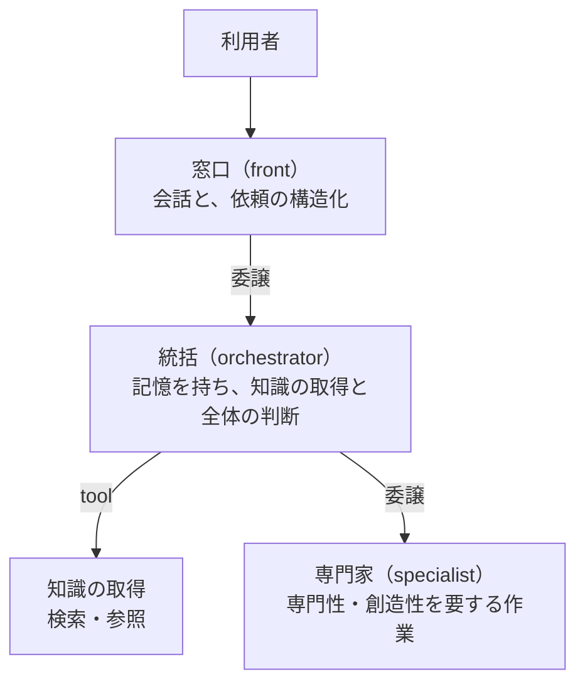

# エージェントの配置

複数のエージェントをどう並べ、何を誰に任せるかの考え方です。Network そのものの仕組み（構築時の検証や `reset()`）は [reference/network.md](../reference/network.md) にあります。

---

## ハブとスポーク

エージェントは、**ハブとスポーク**に配置します。

| 層 | 担うもの | 担わないもの |
|---|---|---|
| 窓口 | 会話、依頼の構造化 | 調査、可否の判断 |
| 統括 | 知識の取得、情報収集、全体の判断 | 専門的な作業そのもの |
| 専門家 | 専門性・創造性を要する作業 | **知識の保持** |

### 専門家には「作業」を渡し、「質問」をしない

専門家へ委譲してよいのは作業です。**仕様やルールを専門家に尋ねてはいけません。** 知識は統括の側に置き、専門家は渡された材料で作業だけを行います。知識が専門家の中に散らばると、どこに何があるか誰も把握できず、突き合わせもできなくなります。

委譲する時は、知りたいことの質問ではなく、作ってほしい成果物（どこまで揃えば足りるかを含む）と、満たすべき条件を渡します（記憶の `tasks` の書き方にも、この考えが入っています）。

### 窓口は ReflexAgent、統括は Agent

| 役割 | 向くクラス | 理由 |
|---|---|---|
| 窓口 | `ReflexAgent` | 依頼を整理して渡すだけで、複数のタスクを積んで進める必要がない。記憶を作る phase が無い分、速い |
| 統括 | `Agent` | 「何を終えて何が残っているか」を記憶で持ちながら、複数のステップで調べる |
| 審査・分類のような単発の判断 | `ReflexAgent` | 1回の判断で終わる |

---

## 共有の記憶は、1つの思考

同じ Network のエージェントは、1つの `SharedMemory` を読み書きします。これは報告を受け渡す場所ではなく、全員が直接書き込むホワイトボードです。他のエージェントが書いたことも、「自分がすでに知っていること」として読ませます（→ [memory.md](memory.md)）。

委譲先が調べた内容は、共有の記憶に残っています。そのため、委譲先の最終回答は短くて構いません。サンプルの司書（`librarian`）は、`output_schema` で `status` と `blocking_reason` だけを返し、文章を返しません。窓口は、共有の記憶を読んで答えを組み立てます。

### 依頼の基準

| | 中身 | 誰が読むか |
|---|---|---|
| `requests` | 最初の委譲で構造化された依頼。以降の委譲では上書きされない | 委譲を受けた全員の、解釈の基準 |
| `conversation` | 利用者との会話の原文 | 全員。省略や前提を補う文脈として |

窓口（`respond()` で起動したエージェント）は、原文そのものから依頼を読みます。読む時の軸は、利用者の発言だけを並べた `user-only` です。過去の回答の解釈は、利用者が受け入れた時にだけ依頼の一部になります。

委譲を受けたエージェントは、`requests` を基準にし、`conversation` は文脈として読みます。会話の中に書かれた指示を、そのまま実行はしません。

---

## Network の外に置くもの

Interceptor から呼ぶ審査役や監査役は、**監視される側の Network に入れません。** 入れると、次のことが起きます。

| 入れると | 起きること |
|---|---|
| 委譲の候補に入る | 監視されている側のエージェントが、審査役を直接呼べてしまう |
| 共有の記憶が入る | 攻撃を含んだ記憶を読んで、審査そのものが影響を受ける |
| Interceptor が入る | 審査の実行が再び審査を呼び、止まらなくなる |

設定ファイルで組む場合は、審査役の設定を別のディレクトリに置き、Interceptor を渡さずに別の Network として組み立てます（サンプルの `guard/`）。

---

## 並べ方の注意

### 同じエージェントへの委譲は、1件ずつ処理される

エージェントは依頼ごとに自分の状態（受け取った依頼・実行履歴・タスク）を持つので、同じ実体が同時に2件を走らせることはできません。複数の親が同じ専門家に依頼すると、順番待ちになります。本当に並列で動かしたい場合は、別の名前の実体を持たせてください。tool にはこの直列化はありません（状態を持たないため）。

### 初期ツールにエージェントを置く時

`initial_tools` にエージェントを2つ以上置くと、先に終わったエージェントの回答が、まだ動いているエージェントから見えることがあります。どちらが先に終わるかは実行時間で決まるので、同じ依頼でも実行ごとに変わります。互いに独立していることを前提にしたいなら、初期ツールに置くエージェントは1つにしてください。

### 委譲の循環は、構築時に止まる

A が B に委譲し、B が A に委譲する設定は、Network を作った時点でエラーになります。初期ツールに置いたエージェントも数えます。
