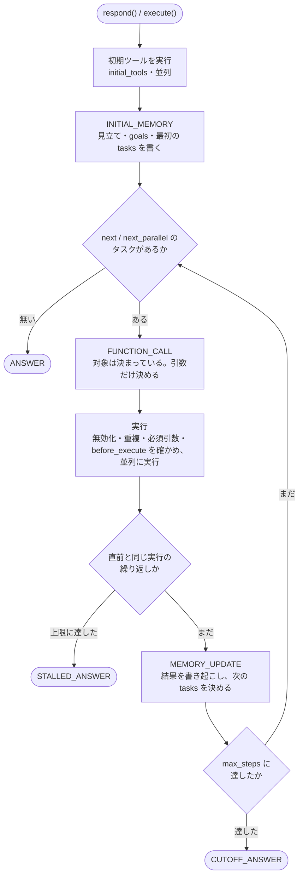

# エージェントの1回の応答

`Agent` と `ReflexAgent` が、1回の起動の中で何をしているかの流れです。実装は `src/statecraft/agent.py` にあります。

---

## 入口は2つ

| 入口 | 誰が呼ぶか | 何が違うか |
|---|---|---|
| `respond(message=, history=, blobs=)` | 利用側（人間からの入口） | 原文と会話履歴を共有の記憶の `conversation` に記録する。依頼は `conversation` から読む |
| `execute(kwargs=, interceptor=)` | 他のエージェント（委譲） | `before_execute` を通る。最初の委譲なら、依頼を `requests` に記録する。終わったら回答を `agent_answers` に記録し、`ToolResult` で返す |

`execute()` は `Tool.execute()` と同じ形なので、呼ぶ側から見ると、委譲先が tool でもエージェントでも同じに扱えます（`Invokable`）。同じ実体への `execute()` は、ロックで1件ずつに直列化されます。

### 起動ごとに捨てるもの・残すもの

起動のたびに、前回の実行の痕跡を捨てます（同じリクエストの中で、同じエージェントが何度も呼ばれることがあるため）。

| 捨てる | 残す |
|---|---|
| `tasks`（`next` のまま残ると、前回の依頼のための実行が起きる） | `goals`、`task_notes` |
| 実行履歴、直前に成功した呼び出しの記録 | 共有の記憶 |
| その起動で行った無効化 | 継承する思考（`carry_thoughts`） |
| 停滞の数え、反映されなかった行、周回数、抱えた添付 | トークンの累計 |

`run_id` は起動ごとに新しく発行されます。リクエストの区切りで全部を消すには `reset()` を使います（→ [network.md](network.md)）。

---

## Agent のループ

### 1. 初期ツールと、初期の記憶

`initial_tools` に置いたものを、LLM に選ばせずに並列で実行します。引数は、自分の `input_schema` の同じ名前の項目から渡ります。結果を材料に、`INITIAL_MEMORY` で最初の記憶を作ります。

### 2. 実行する対象を選ぶ

個別の記憶の `tasks` のうち、`status` が `next` / `next_parallel` のものの `target_names` を集めます。

- 1つも無ければ、`ANSWER` へ進みます。
- 名前が解決できない・無効化されている対象は、失敗の結果として記録し、記憶の更新で直させます（黙って除外すると、`next` のまま残っているのに実行対象が空になり、未実行のまま回答へ飛ぶため）。

### 3. FUNCTION_CALL

集めた対象だけを API へ渡し、`tool_choice="any"` で呼び出しを強制します。この生成が決めるのは引数だけです。

呼び出し要求が返らなかった場合:

| 返ってきたもの | 扱い |
|---|---|
| テキストも呼び出しも無い | ステップを1つ消費して、次の周で再試行する |
| テキストだけ | 強制したのにテキストが返った。改めて `ANSWER` で答えさせる |

### 4. 実行

1回の生成で複数の呼び出しが返った場合、**ツールの関数は同時に呼ばれます。** 実行の前に、1件ずつ次を確かめます。

- 無効化されていないか
- 直前のステップで成功した呼び出しと、名前と引数が全く同じでないか（同じなら実行せずに拒否する）
- 必須の引数が空でないか（`None`、空文字、空白だけの文字列は空とみなす。`0` / `False` / `[]` は通す）
- `before_execute` が許可するか

ツールが戻り値の `memory` で記憶へ直接書く内容は、全部の実行が終わってから書き込みます。

### 5. 停滞の確認

そのステップで起きたこと（名前・引数・エラー）の集合を「指紋」にして、直前のステップと比べます。成功した呼び出しは重複として拒否されるので、指紋が一致するのは、失敗や拒否を繰り返している時だけです。

- 1回目の一致: `MEMORY_UPDATE` に `STALL_NOTICE` を差し込み、立て直しを促します。
- `max_stalled_steps`（既定 2）に達したら: 打ち切って `STALLED_ANSWER` で答えます。

### 6. MEMORY_UPDATE

今回の実行結果（と tool が返した添付）を材料に、記憶の差分を作らせます。結果の本文が見えるのは、この1回だけです。差分の当て方と差し戻しは、[concepts/memory.md](../concepts/memory.md) と [concepts/failure-handling.md](../concepts/failure-handling.md) にあります。

今回呼ばれた対象を指すタスクが `next` のまま残っていれば、差し戻して閉じさせます。

### 7. 最終回答

| phase | いつ |
|---|---|
| `ANSWER` | 実行すべきタスクが無くなった（正常な終わり方） |
| `CUTOFF_ANSWER` | `max_steps` を使い切った |
| `STALLED_ANSWER` | 停滞を検出して打ち切った |

- `answer_knowledge` を【この回答のためのナレッジ】として載せます。
- 実行されないまま残ったタスク（`next` / `next_parallel` / `conditional`）があれば、【実行されていないタスク】として知らせます。実行していないことを、実行したかのように書かせないためです。
- `output_schema` があれば API で形を強制し、それでも JSON として読めなければ1回だけ作り直させます。
- それでも本文が空なら、システムの通知文を返します。

---

## ループの出口（5つ）

| 出口 | 回答 |
|---|---|
| 実行すべき対象が無くなった | `ANSWER` |
| 同じ実行を繰り返して進まない | `STALLED_ANSWER` |
| `max_steps` に達した | `CUTOFF_ANSWER` |
| `ReflexAgent` がテキストで答えた | そのテキストをそのまま返す |
| 呼び出しを強制したのにテキストが返った | `ANSWER` で答え直す |

---

## Agent と ReflexAgent の違い

ループの本体（`_run_react`）は共通で、違いは途中の差し込み口（hook）の中身だけです。

| | `Agent` | `ReflexAgent` |
|---|---|---|
| 記憶 | 共有と個別の両方を持つ | 個別の記憶は持たない（共有の記憶は読む） |
| 初期の記憶 | 初期ツールの結果から作る | 作らない（初期ツールは実行する） |
| 何を呼ぶか | 記憶のタスクの対象だけを提示し、`"any"` で強制 | 有効な全ツールを提示し、`"auto"` で選ばせる |
| 結果の扱い | 記憶へ書き起こし、以降は本文を隠す | 実行履歴に残り続ける |
| 添付 | 評価する1回だけ | 書き起こす先が無いので、以降の生成へ送り続ける |
| 停滞の立て直し | 1回だけ `STALL_NOTICE` で促す | 記憶の更新が無いので、検出したら打ち切る |
| `output_schema` | `ANSWER` で API に強制させる | 指示文として伝わるだけ |
| 1往復の生成回数 | 多い（計画・実行・評価・回答） | 少ない（実行・回答） |

---

## 生成とトークン

- 生成は必ず `_generate()` を通ります。ここを通った生成だけがトークンを積算し、`generated` イベントを流します。
- phase ごとの生成設定（モデル・接続・温度・最大トークン・思考の深さ）は、`phase_overrides` の指定がある項目だけを差し替えて決まります。
- `respond()` が返す `AgentResponse` のトークン数は、その応答の分だけです。Network 全体の累計は `Network.total_tokens()` で見ます。
